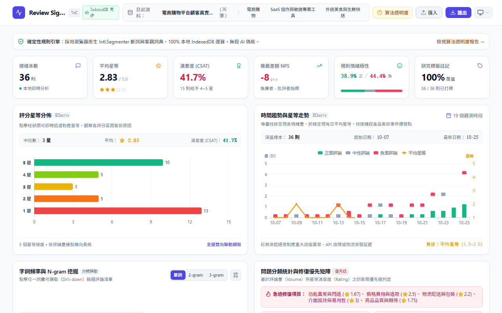

# Review Signal

[繁體中文](README.zh-TW.md) · **English**

> **Pure Frontend Voice of Customer & Review Research Studio**, 100% in-browser sandbox computation with zero server data transfer.

<p align="center">
  
</p>

<p align="center">
  <a href="https://github.com/ReiKama414/review-signal">GitHub</a> ·
  <a href="https://reikama414.vercel.app/">Portfolio</a> ·
  <a href="#key-highlights">Highlights</a> ·
  <a href="#getting-started">Getting Started</a> ·
  <a href="#testing--validation">Validation</a> ·
  <a href="#license">License</a>
</p>

---

## Key Highlights

- **Pure In-Browser Computation** — All file parsing, Chinese tokenization, rule-based sentiment scoring, and chart rendering execute locally in the client browser with zero server dependencies or data transmission.
- **Deterministic Rule-Based Sentiment Engine** — Adapted from the NTUSD sentiment lexicon, integrating sliding window negation reversal ("not", "never", "unable") and degree adverb multipliers (1.4x to 1.8x), providing a fully auditable hyperbolic normalization formula and feature evidence chain.
- **Native Browser Chinese Segmentation** — Native `Intl.Segmenter` Chinese text segmentation augmented with 200+ domain compound terms for Taiwan e-commerce, SaaS software, and on-demand delivery, requiring zero heavy external dictionary or model downloads.
- **N-gram Mining & Cross-Filtering Drill-Down** — Instant switching across 1-gram, 2-gram, and 3-gram language blocks with custom stopwords management; clicking any token immediately cross-filters and highlights matching customer reviews.
- **Four-Quadrant Action Priority Matrix** — Synthesizes complaint volume share and average customer rating to categorize operational friction into Critical Action, High Priority, Medium Priority, and Healthy.
- **Five-Zone Isolated Chart Visualization** — Interactive ECharts rating distribution histogram with click-to-filter, dual-axis stacked volume timeline, and daily rating trend line; strictly separated Header, Description, Statistics, Chart Canvas, and Footer zones to eliminate overlap.
- **Responsive Design & Dual Theme** — Support for System, Light, and Dark modes across 9 distinct viewports (320px to 1920px), engineered with a strict Zero-Overlap Document Flow layout that scales naturally under 200% text magnification.
- **IndexedDB Offline Persistence** — Browser-native storage engine automatically persists datasets, custom manual tags, and qualitative researcher notes across browser restarts.

---

## Built-in Datasets

The studio comes preloaded with three real-world scenario datasets, while also supporting custom CSV and JSON drag-and-drop ingestion:

| Dataset Name | Dimensions | Key Attributes | Analytical Focus |
| :--- | :--- | :--- | :--- |
| Taiwan E-Commerce Customer Reviews | 36 reviews · 8 fields | Rating, Content, Date, Category, Tags, Device, Version | Shipping delays, coupon checkout errors, app version crash, return and refund disputes |
| SaaS Agile Collaboration Tool Feedback | 24 reviews · 8 fields | Rating, Content, Date, Category, Tags, Device, Version | Kanban board memory spikes, API rate limiting, offline sync conflict, pricing strategy |
| Food Delivery & Fresh Grocery Reviews | 30 reviews · 8 fields | Rating, Content, Date, Category, Tags, Device, Version | Delivery timeouts, soup spillage, ignored customer notes, customer support refund speed |

---

## Mathematical Precision Guarantees

Every analytical algorithm and scoring metric is verified via independent unit tests (100% pass rate) to guarantee mathematical consistency with raw customer feedback:

- **Smooth Hyperbolic Normalized Sentiment Score**:
  $$\text{Score} = \frac{\text{PositiveScore} - \text{NegativeScore}}{\text{TotalScore} + 0.5} \in [-1.0, +1.0]$$
- **Negation Modifier (Sliding Window)**:
  Detects preceding negation tokens ("不", "沒", "無", "未", "非", "無法") within a 3-token forward window, inverting target token polarity ($\times -1.0$).
- **Intensifier Modifier (Sliding Window)**:
  Detects degree adverbs ("超", "非常", "極度", "太", "無比") within a 2-token forward window, applying a multiplier of $1.4\times \sim 1.8\times$.
- **Customer Satisfaction Score (CSAT)**:
  $$\text{CSAT} = \frac{\text{Count}(\text{Rating} \ge 4)}{N} \times 100\%$$
- **Net Promoter Score Proxy (NPS)**:
  $$\text{NPS} = \left(\frac{\text{Count}(\text{Rating} \ge 4) - \text{Count}(\text{Rating} \le 2)}{N}\right) \times 100$$
- **Four-Quadrant Action Matrix Thresholds**:
  $$\text{Critical} \iff (\text{Rating} < 2.5) \land (\text{Share} \ge 15\%), \quad \text{High} \iff (\text{Rating} < 3.0) \lor (\text{Share} \ge 25\%)$$

---

## Tech Stack

| Layer | Technology | Purpose |
| :--- | :--- | :--- |
| Frontend Framework | React 18 · TypeScript | Component modularity and strict type-safety guarantees |
| Build Tool | Vite | Ultra-fast local development server and optimized Rollup production bundling |
| Styling & Theme | Tailwind CSS | High-density workbench aesthetic with unified dark/light design tokens |
| Data Visualization | Apache ECharts | Responsive charts, containLabel layout isolation, and dual-axis composed timeline |
| Data Ingestion | PapaParse | High-performance streaming CSV parser with UTF-8 BOM export support |
| Local Persistence | Native IndexedDB (`idb`) | Multi-dataset persistence, manual tags, and researcher notes restoration |
| UI Iconography | Lucide Icons | Minimal, pixel-crisp geometric vector icons |
| Automated Testing | Playwright · Vitest | E2E user flows, 9-viewport RWD, theme switching, and zero-overlap layout verification |

---

## Getting Started

### Prerequisites

Node.js 18+ and npm.

### Installation & Development

```bash
# 1. Install dependencies
npm install

# 2. Start local development server
npm run dev -- --port 3008
```

Open the printed local URL (default: `http://localhost:3008`) in your browser.

### Production Build & Preview

```bash
# Execute TypeScript checking and production bundle
npm run build

# Preview production build locally
npm run preview
```

---

## User Workflow

1. **Dataset Loading**: Choose between 3 preloaded real-world datasets, drag-and-drop local CSV/JSON files, or paste raw clipboard content.
2. **Quality & Overview Diagnostics**: Inspect total review counts, average ratings, CSAT satisfaction, NPS proxy scores, and lexicon polarity ratios.
3. **Rating Distribution Filtering**: Click any bar in the rating histogram to isolate specific star ratings; click reset to restore all observations.
4. **Timeline & Spike Tracking**: Examine daily stacked volume distributions alongside average rating trends to locate product incidents and operational spikes.
5. **N-gram Mining & Token Drill-Down**: Switch between 1-gram, 2-gram, and 3-gram language blocks to identify root-cause keywords and drill down into matching customer reviews.
6. **Stopwords Customization**: Access the stopwords drawer to add or remove noise tokens, keeping the keyword cloud focused on actionable product insights.
7. **Action Priority Matrix**: Review 8 functional categories ranked across the four-quadrant action matrix with immediate red alerts for critical issues.
8. **Deep Inspection & Export**: Open any review to audit rule-based mathematical evidence, add manual tags (`#Bug`), save researcher notes, and export UTF-8 BOM CSV, JSON, or Markdown reports.

---

## Testing & Validation

The project undergoes automated validation covering rule accuracy, layout stability, and browser workflows (25 automated tests):

```bash
# Run deterministic rule & parsing unit tests
npm test

# Run full Playwright browser suite (Interaction, 9 Viewports RWD, Zero-Overlap)
npm run test:e2e
```

Validation Checklist:

- **Mathematical & Lexical Precision**: Tokenization compound preservation, sliding window negation, intensifier weighting, and classification matrices verified to 100% numerical accuracy.
- **Interactive Workflows**: Dataset switching, full-text keyword search, multi-dimensional filtering, token drill-down, methodology sandbox, manual tagging, and report exports.
- **RWD Verification**: Zero horizontal page overflow verified across 320px, 375px, 390px, 430px, 768px, 1024px, 1280px, 1440px, and 1920px viewports.
- **Dual Theme Support**: System preference detection, light/dark mode toggling, and localStorage persistence.
- **Zero-Overlap Architecture**: Non-intersecting bounding box verification between titles, statistics, chart canvases, and legends under 100% and 200% zoom levels.

---

## Known Limitations

> **Note:**
> 1. All calculations execute on the browser's single thread; datasets under 50,000 rows or 20MB are recommended for optimal 60fps interaction.
> 2. Offline storage relies on the browser's IndexedDB storage quota. Incognito sessions will clear persisted datasets upon closing the window.
> 3. Uploaded CSVs should be UTF-8 encoded; please convert legacy Big5 CSVs before loading.

---

## License

Copyright (c) ReiKama414. All rights reserved.

This software and its source code are provided solely for personal viewing and learning purposes.
No permission is granted to use, copy, modify, distribute, sublicense, or incorporate this software
or any part of it into other projects, whether for commercial or non-commercial purposes,
without the express written consent of the copyright holder.

- [GitHub](https://github.com/ReiKama414/review-signal)
- [Portfolio](https://reikama414.vercel.app/)
- [Full License](./LICENSE)

---

<sub>Review Signal · Customer Voice & Review Research Studio · ReiKama414</sub>
