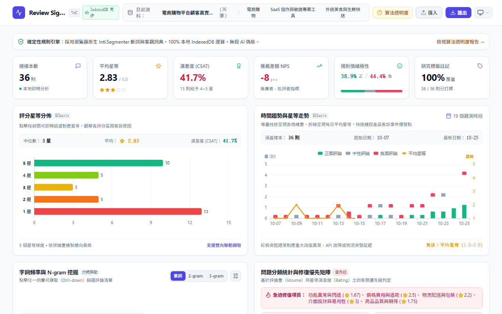

# Review Signal

**繁體中文** · [English](README.md)

> **顧客之聲 (VoC) 與評論研究專業工作台**，100% 瀏覽器本地沙盒運算，零伺服器資料傳輸

<p align="center">
  
</p>

<p align="center">
  <a href="https://github.com/ReiKama414/review-signal">GitHub</a> ·
  <a href="https://reikama414.vercel.app/">個人網站</a> ·
  <a href="#核心亮點">核心亮點</a> ·
  <a href="#快速開始">快速開始</a> ·
  <a href="#驗證與測試">驗證與測試</a> ·
  <a href="#license--權限">授權</a>
</p>

---

## 核心亮點

- **純瀏覽器本地沙盒運算** — 所有資料解析、斷詞重組、情緒計分與圖表渲染皆在使用者瀏覽器本地執行，完全零後端依賴與伺服器資料傳輸
- **確定性規則情感引擎** — 改編自 NTUSD 情感詞庫，結合否定詞極性翻轉（「不」、「未」、「無法」）與程度副詞強度加權（1.4x ~ 1.8x），提供完全公開的平滑雙曲歸一化數學公式與特徵證據鏈
- **原生中文斷詞與複合詞組** — 調用瀏覽器原生 `Intl.Segmenter`，內建 200+ 電商、SaaS 軟體與外送物流領域專屬複合詞庫，零外部大型權重下載
- **N-gram 探勘與雙向鑽取** — 支援 1-gram、2-gram、3-gram 即時切換，提供自訂停用詞管理，點擊任一詞彙即時過濾並高亮標記對應評論
- **四象限修復優先級矩陣** — 結合評論量佔比 (Volume) 與平均星等 (Rating)，自動判定「緊急修復」、「重點關注」、「持續優化」與「表現良好」
- **獨立五分區圖表可視化** — 評分星等直方圖點選過濾、雙 Y 軸時序堆疊柱與平均星等走勢折線，嚴格劃分 Header、Description、Statistics、Chart、Footer，杜絕重疊遮擋
- **全響應式與黑白雙主題** — 支援跟隨系統、淺色與深色三種模態，適配 320px 至 1920px 九種螢幕尺寸，全域採用無重疊（Zero-Overlap）獨立 Document Flow 排版架構
- **IndexedDB 離線持久化儲存** — 採用 `idb` 非同步資料庫，資料集、自訂標籤與質化研究筆記在瀏覽器重啟後完整留存，100% 離線可用

---

## 內建實戰資料集

系統預載三組實戰資料集，亦支援隨時拖曳匯入自訂 CSV、TSV 或 JSON：

| 資料集名稱 | 規格 | 特徵屬性 | 探索重點 |
| :--- | :--- | :--- | :--- |
| 台灣電商購物平台顧客反饋 | 36 則 · 8 欄位 | 星等、評論內容、日期、分類、標籤、裝置、版本 | 物流配送時效、優惠券結帳異常、App 改版閃退、退換貨客訴 |
| SaaS 敏捷協作工具用戶反饋 | 24 則 · 8 欄位 | 星等、評論內容、日期、分類、標籤、裝置、版本 | 大量看板記憶體狂飆、API 呼叫限流、離線資料同步衝突、定價策略 |
| 美食外送與生鮮快送評論 | 30 則 · 8 欄位 | 星等、評論內容、日期、分類、標籤、裝置、版本 | 外送延遲超時、餐點湯汁傾倒、備註事項忽視、客服退款效率 |

---

## 統計數學公式保證

所有情緒計分與統計指標皆經過獨立單元測試驗證（100% 通過），確保各項分析結果與原始資料完全一致：

- **平滑雙曲歸一化評分 (Normalized Score)**：
  $$\text{Score} = \frac{\text{PositiveScore} - \text{NegativeScore}}{\text{TotalScore} + 0.5} \in [-1.0, +1.0]$$
- **否定詞動態極性翻轉 (Negation Modifier)**：
  探測向前滑動視窗內之「不、沒、無、未、非、無法」，反轉後續詞彙之極性（權重乘以 $-1.0$）
- **程度副詞強度加權 (Intensifier Weighting)**：
  探測向前滑動視窗內之「超、非常、極度、太、無比」，乘上 $1.4\times \sim 1.8\times$ 強度倍率
- **顧客滿意度指標 (CSAT)**：
  $$\text{CSAT} = \frac{\text{Count}(\text{Rating} \ge 4)}{N} \times 100\%$$
- **淨推薦值代理估算 (NPS Proxy)**：
  $$\text{NPS} = \left(\frac{\text{Count}(\text{Rating} \ge 4) - \text{Count}(\text{Rating} \le 2)}{N}\right) \times 100$$
- **四象限優先級界限 (Priority Thresholds)**：
  $$\text{Critical} \iff (\text{Rating} < 2.5) \land (\text{Share} \ge 15\%), \quad \text{High} \iff (\text{Rating} < 3.0) \lor (\text{Share} \ge 25\%)$$

---

## 技術棧

| 層級 | 技術選型 | 用途說明 |
| :--- | :--- | :--- |
| 前端框架 | React 18 · TypeScript | 高效元件化開發與嚴格型別安全檢查 |
| 建置工具 | Vite | 極速本機開發伺服器與 Rollup 生產打包 |
| 樣式管理 | Tailwind CSS | 高資訊密度專業工作台風格與雙主題規範 |
| 圖表繪製 | Apache ECharts | 互動式資料圖表、containLabel 自動留白與響應式重繪 |
| 資料解析 | PapaParse | 瀏覽器端高效 CSV / JSON 解析與 UTF-8 BOM 支援 |
| 本地儲存 | 原生 IndexedDB (`idb`) | 多資料集持久化儲存、手動標籤與研究筆記離線保存 |
| 圖示庫 | Lucide Icons | 統一、精緻的幾何向量圖示 |
| 自動化測試 | Playwright · Vitest | E2E 互動、RWD 九尺寸、雙主題切換、零重疊排版與演算法精準測試 |

---

## 快速開始

### 系統需求

需要 Node.js 18+ 與 npm

### 安裝與啟動

```bash
# 1. 安裝依賴
npm install

# 2. 啟動本機開發伺服器
npm run dev -- --port 3008
```

啟動後於瀏覽器開啟提示之本機網址（預設為 `http://localhost:3008`）

### 生產建置與預覽

```bash
# 執行 TypeScript 型別檢查與生產打包
npm run build

# 本地預覽生產版本
npm run preview
```

---

## 操作流程

1. **載入或切換資料集**：點擊頂部內建範例標籤（電商購物、SaaS 協作、外送美食），或點擊「匯入」拖曳上傳 CSV/JSON
2. **檢視指標與健康分佈**：在總覽卡片查看總樣本數、平均星等、CSAT 滿意度、NPS 差額評估、規則極性佔比與標籤覆蓋率
3. **星等直方圖互動篩選**：點擊「評分星等分佈」長條圖柱體，即時過濾對應星等評論，再次點擊或點擊「重設」還原全選
4. **時序與事件走勢追蹤**：在「時間趨勢與星等走勢」觀察各日正面／中性／負面堆疊量，對比平均星等折線，捕捉客訴爆發節點
5. **字詞與 N-gram 探勘**：在分詞區塊切換單詞、2-gram、3-gram，點擊任意詞彙即時鑽取篩選，下方評論列表即刻高亮標記
6. **管理自訂停用詞**：點擊分詞區右上角滑桿圖示，即時新增或移除停用詞彙，過濾無分析價值的贅字虛詞
7. **優先級矩陣與分類診斷**：在「問題分類統計」檢視 8 大維度佔比與緊急修復警示，點擊分類卡片即可連動縮減評論列表
8. **深度檢視與成果匯出**：點擊任一評論之「深入檢視」展開規則公式樹狀圖與記錄筆記，點擊「匯出」下載含 UTF-8 BOM 之 CSV、JSON 或完整 Markdown 報告

---

## 驗證與測試

本專案經過嚴格演算法規則精準度與自動化瀏覽器驗收（共 25 項測試）：

```bash
# 執行演算法規則與資料解析單元測試
npm test

# 執行全套 Playwright 瀏覽器測試
npm run test:e2e
```

測試驗證清單：

- **規則精度**：斷詞重組、滑動視窗修飾機制、情感評分公式、分類優先矩陣 100% 正確
- **互動流程**：資料集切換、全文檢索、多維篩選、字詞鑽取、透明度沙盒、手動打標、質化筆記與檔案匯出
- **全裝置 RWD**：驗證 320px、375px、390px、430px、768px、1024px、1280px、1440px、1920px 九種解析度，無水平溢出
- **黑白雙主題**：跟隨系統偏好、淺色模式與深色模式之切換與持久化
- **Zero-Overlap 排版完整性**：卡片標題、統計數值、圖表畫布與圖例邊界不相交驗收，支援瀏覽器 200% 文字放大

---

## 已知限制

> **提醒：**
> 1. 所有計算皆於使用者瀏覽器單執行緒即時執行，建議單次匯入資料集規模控制在 50,000 列或 20MB 以內，以維持最流暢之互動體驗
> 2. 本地資料持久化依賴瀏覽器 IndexedDB 儲存配額；若於無痕視窗（Incognito）操作，關閉瀏覽器後儲存內容將自動抹除
> 3. 匯入之 CSV 建議使用 UTF-8 編碼，若為舊版 Excel 匯出之 Big5 編碼請先轉存為 UTF-8

---

## License / 權限

Copyright (c) ReiKama414. All rights reserved.

本專案僅供個人瀏覽與學習。未經著作權人書面同意，不得使用、複製、修改、散布或併入其他專案（含非商業用途）

- [GitHub](https://github.com/ReiKama414/review-signal)
- [個人網站](https://reikama414.vercel.app/)
- [授權全文](./LICENSE)

---

<sub>Review Signal · 顧客之聲與評論研究專業工作台 · ReiKama414</sub>
